# FindIt — Database Design & Schema Specifications

> **ORM:** SQLAlchemy 2.0  
> **Schema Migrations:** Alembic  
> **Supported Engines:** SQLite (Local Development) & PostgreSQL (Production / Cloud)

---

## 1. Entity-Relationship Diagram (ERD)

```mermaid
erDiagram
    USERS ||--o{ ITEMS : "reports"
    USERS ||--o{ CLAIMS : "submits"
    USERS ||--o{ CLAIMS : "receives"
    USERS ||--o{ NOTIFICATIONS : "receives"
    ITEMS ||--o{ CLAIMS : "targeted_by"
    ITEMS ||--o{ NOTIFICATIONS : "referenced_in"
    CLAIMS ||--o{ NOTIFICATIONS : "referenced_in"

    ITEMS ||--o{ MATCHES : "lost_match"
    ITEMS ||--o{ MATCHES : "found_match"

    USERS {
        string id PK "usr_<uuid>"
        string email UK "Campus email"
        string hashed_password "Salted Bcrypt"
        string full_name "Student / Staff Name"
        string role "student | staff | admin"
        string campus "Campus designation"
        string avatar_url "Optional avatar URL"
        boolean is_active "Account status"
        boolean is_demo "Demo seed flag"
        datetime created_at "UTC timestamp"
        datetime updated_at "UTC timestamp"
    }

    ITEMS {
        string id PK "item_<uuid>"
        string user_id FK "Reporter user ID"
        string title "Item name"
        string description "Item details"
        string category "Electronics, Bags, etc."
        string type "lost | found"
        string status "open | in_claim | resolved | returned"
        string location "Building or room"
        string campus "Campus location"
        string date "Date lost or found"
        string image_url "Optional image URL"
        string reporter_name "Display name"
        string reporter_contact "Contact details"
        boolean is_demo "Demo seed flag"
        datetime created_at "UTC timestamp"
        datetime updated_at "UTC timestamp"
    }

    CLAIMS {
        string id PK "clm_<uuid>"
        string item_id FK "Target item ID"
        string claimant_id FK "Claimant user ID"
        string item_owner_id FK "Reporter user ID"
        string description "Explanation of ownership"
        string proof_details "Confidential proof"
        string status "pending | under_review | approved | rejected | completed | cancelled"
        string review_notes "Reporter notes"
        string handover_status "awaiting_handover | handover_arranged | returned_successfully"
        string handover_details "Meeting instructions"
        datetime created_at "UTC timestamp"
        datetime updated_at "UTC timestamp"
    }

    NOTIFICATIONS {
        string id PK "notif_<uuid>"
        string user_id FK "Recipient user ID"
        string title "Alert headline"
        string message "Alert body text"
        string type "Alert category code"
        string item_id FK "Optional related item"
        string claim_id FK "Optional related claim"
        boolean is_read "Read state flag"
        datetime created_at "UTC timestamp"
    }

    MATCHES {
        string id PK "match_<uuid>"
        string lost_item_id FK "Lost item ID"
        string found_item_id FK "Found item ID"
        float confidence_score "Overall hybrid score"
        float category_score "Category similarity"
        float location_score "Location proximity"
        float date_score "Temporal proximity"
        float semantic_score "Semantic text similarity"
        string explanation "Human-readable explanation"
        string status "suggested | reviewed | accepted | rejected"
        string user_feedback "relevant | not_relevant | already_recovered | duplicate"
        string feedback_remarks "Optional user remarks"
        boolean is_dismissed "User dismissal flag"
        datetime created_at "UTC timestamp"
        datetime updated_at "UTC timestamp"
    }
```

---

## 2. Table Specifications & Indexes

### A. `users` Table
Stores registered student, staff, and administrator profiles.
- `id` (VARCHAR(50), PRIMARY KEY): Unique string identifier prefixed with `usr_`.
- `email` (VARCHAR(255), UNIQUE, INDEXED): Required student email address.
- `hashed_password` (VARCHAR(255), NOT NULL): Salted Bcrypt hashed password.
- `full_name` (VARCHAR(255), NOT NULL): User display name.
- `role` (VARCHAR(50), DEFAULT 'student'): Access role (`student`, `staff`, `admin`).
- `campus` (VARCHAR(100), DEFAULT 'Main Campus'): Primary academic campus.
- `is_active` (BOOLEAN, DEFAULT TRUE): Account status.
- `is_demo` (BOOLEAN, DEFAULT FALSE): Identifies automatically seeded demo users.
- `created_at` / `updated_at` (TIMESTAMP): UTC creation and update timestamps.

### B. `items` Table
Stores reported lost and found belongings.
- `id` (VARCHAR(50), PRIMARY KEY): Unique string identifier prefixed with `item_`.
- `user_id` (VARCHAR(50), FOREIGN KEY `users.id`, ON DELETE SET NULL, INDEXED): Submitting user.
- `title` (VARCHAR(255), NOT NULL, INDEXED): Searchable title.
- `description` (TEXT, NOT NULL): Detailed physical description.
- `category` (VARCHAR(100), NOT NULL, INDEXED): Belonging category.
- `type` (VARCHAR(50), NOT NULL, INDEXED): `lost` or `found`.
- `status` (VARCHAR(50), DEFAULT 'open', INDEXED): `open`, `in_claim`, `resolved`, `returned`.
- `location` (VARCHAR(255), NOT NULL): Specific campus facility or classroom.
- `campus` (VARCHAR(100), NOT NULL, INDEXED): Campus location.
- `date` (VARCHAR(50), NOT NULL): Date item was misplaced or recovered.
- `image_url` (VARCHAR(1024), NULLABLE): Image URL.

### C. `claims` Table
Stores ownership verification claims submitted for found items.
- `id` (VARCHAR(50), PRIMARY KEY): Unique string identifier prefixed with `clm_`.
- `item_id` (VARCHAR(50), FOREIGN KEY `items.id`, ON DELETE CASCADE, INDEXED): Claimed item.
- `claimant_id` (VARCHAR(50), FOREIGN KEY `users.id`, ON DELETE CASCADE, INDEXED): Claimant user.
- `item_owner_id` (VARCHAR(50), FOREIGN KEY `users.id`, ON DELETE SET NULL, INDEXED): Original item reporter.
- `description` (TEXT, NOT NULL): Public reason for claim.
- `proof_details` (TEXT, NULLABLE): **Confidential** ownership proof details (viewable only by participants and admins).
- `status` (VARCHAR(50), DEFAULT 'pending', INDEXED): Current state machine status.
- `review_notes` (TEXT, NULLABLE): Explanatory reviewer notes from the item reporter.
- `handover_status` (VARCHAR(50), NULLABLE, INDEXED): Handover progress status.
- `handover_details` (TEXT, NULLABLE): Meeting instructions and physical location.

### D. `notifications` Table
Stores persistent, user-isolated notification alerts.
- `id` (VARCHAR(50), PRIMARY KEY): Unique string identifier prefixed with `notif_`.
- `user_id` (VARCHAR(50), FOREIGN KEY `users.id`, ON DELETE CASCADE, INDEXED): Recipient user.
- `title` (VARCHAR(255), NOT NULL): Alert headline.
- `message` (TEXT, NOT NULL): Body explanation.
- `type` (VARCHAR(50), NOT NULL, INDEXED): Notification event code (`claim_submitted`, `claim_approved`, `match_found`, etc.).
- `item_id` (VARCHAR(50), FOREIGN KEY `items.id`, ON DELETE SET NULL, INDEXED): Target item.
- `claim_id` (VARCHAR(50), FOREIGN KEY `claims.id`, ON DELETE SET NULL, INDEXED): Target claim.
- `is_read` (BOOLEAN, DEFAULT FALSE, INDEXED): Flag indicating whether notification has been read.
- `created_at` (TIMESTAMP, DEFAULT UTC NOW): Creation timestamp.

### E. `matches` Table
Stores automated AI recommendations pairing lost and found reports.
- `id` (VARCHAR(50), PRIMARY KEY): Unique string identifier prefixed with `match_`.
- `lost_item_id` (VARCHAR(50), FOREIGN KEY `items.id`, ON DELETE CASCADE, INDEXED): Lost item reference.
- `found_item_id` (VARCHAR(50), FOREIGN KEY `items.id`, ON DELETE CASCADE, INDEXED): Found item reference.
- `confidence_score` (FLOAT, NOT NULL, INDEXED): Overall multi-attribute match score ($0.0 - 1.0$).
- `category_score` (FLOAT, DEFAULT 0.0): Sub-score for category similarity.
- `location_score` (FLOAT, DEFAULT 0.0): Sub-score for location proximity.
- `date_score` (FLOAT, DEFAULT 0.0): Sub-score for temporal proximity.
- `semantic_score` (FLOAT, DEFAULT 0.0): Sub-score for text semantic similarity.
- `explanation` (TEXT, NULLABLE): Human-readable reasoning for the recommendation.
- `status` (VARCHAR(50), DEFAULT 'suggested', INDEXED): `suggested`, `reviewed`, `accepted`, `rejected`.
- `user_feedback` (VARCHAR(50), NULLABLE, INDEXED): `relevant`, `not_relevant`, `already_recovered`, `duplicate`.
- `feedback_remarks` (TEXT, NULLABLE): Claimant/reporter commentary on recommendation accuracy.
- `is_dismissed` (BOOLEAN, DEFAULT FALSE, INDEXED): User UI dismissal state.
- `created_at` / `updated_at` (TIMESTAMP, DEFAULT UTC NOW): Creation and update timestamps.
- **Unique Constraint:** `uq_lost_found_pair` on `(lost_item_id, found_item_id)`.

---

## 3. Database Dialect Compatibility

The data layer is engineered to be 100% portable between SQLite and PostgreSQL:

| Feature | SQLite (Local Development) | PostgreSQL (Cloud / Production) |
|---|---|---|
| **Primary Keys** | `VARCHAR(50)` with UUID hex string | `VARCHAR(50)` with UUID hex string |
| **Foreign Keys** | Enabled via `PRAGMA foreign_keys=ON` | Native ANSI SQL foreign keys with cascades |
| **Batch Schema Migrations** | Supported via Alembic `render_as_batch=True` | Supported natively |
| **Booleans** | Native `0` / `1` emulation | Native `BOOLEAN` |
| **Connection Pooling** | `NullPool` (avoids file locking issues) | `QueuePool` with pre-ping and SSL enforcement |

---

## 4. Alembic Migration History

| Revision ID | Description | Down Revision |
|---|---|---|
| `20261011_01` | Initial schema for users, items, claims, and notifications. | Base |
| `20261014_01` | Schema upgrade: password hashing, avatar URL, reporter details, demo flag. | `20261011_01` |
| `20261014_02` | Milestone 7 expansion: item owner reference, proof details, reviewer notes, handover coordination, relational notification keys. | `20261014_01` |
| `20261015_01` | Milestone 9 AI smart matching schema: `matches` table with hybrid scores, explainability, feedback, and unique pair constraints. | `20261014_02` |
