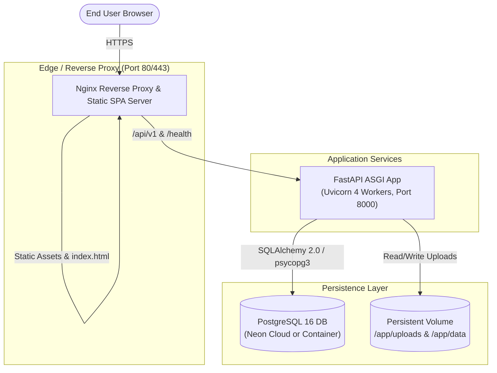

# FindIt — Production Deployment Guide

> **Target Environments:** Docker & Docker Compose, Cloud VPS (Ubuntu / Debian), Cloud Container Platforms (Render, Railway, Fly.io)  
> **Database:** PostgreSQL 16+ (Docker or Neon Cloud Serverless PostgreSQL)  
> **Backend Server:** FastAPI with Gunicorn/Uvicorn Workers  
> **Frontend Server:** Production Nginx SPA Container or Static Host (Vercel, Netlify, Cloudflare Pages)

---

## 1. Architecture Overview for Production



---

## 2. Docker & Docker Compose Deployment (Recommended)

FindIt includes a ready-to-run multi-container setup in `docker-compose.yml` orchestrating PostgreSQL, FastAPI Backend, and Nginx React Frontend.

### Prerequisites
- Docker Engine 24+
- Docker Compose v2+

### Step 1: Prepare Environment Configuration

Create a production `.env` file in the project root:

```bash
# General
ENVIRONMENT=production
PROJECT_NAME="FindIt Campus Lost & Found"

# Security (CRITICAL: Generate a strong 32+ character random secret)
JWT_SECRET_KEY=replace_this_with_a_secure_random_64_character_hex_string
ACCESS_TOKEN_EXPIRE_MINUTES=1440

# Database Configuration (Docker Compose internal network)
POSTGRES_SERVER=db
POSTGRES_PORT=5432
POSTGRES_USER=findit_admin
POSTGRES_PASSWORD=replace_with_strong_database_password
POSTGRES_DB=findit_prod

# Database Connection URI (Normalizes for psycopg3)
DATABASE_URL=postgresql+psycopg://findit_admin:replace_with_strong_database_password@db:5432/findit_prod

# CORS Origins (Comma-separated list of allowed production domains)
BACKEND_CORS_ORIGINS=https://findit.campus.edu,http://localhost:5173

# Frontend Production API URL
VITE_API_URL=https://findit.campus.edu/api/v1
```

### Step 2: Build and Launch Containers

```bash
# Build images and start services in background
docker compose up -d --build

# Inspect running container status
docker compose ps

# Check logs
docker compose logs -f backend
```

### Step 3: Run Alembic Migrations

Once the database container is healthy:

```bash
docker compose exec backend alembic upgrade head
```

---

## 3. Cloud Platform Deployment (PaaS / Free Tier Evaluation)

For deploying FindIt to managed cloud platforms, the following options provide low-barrier or free-tier hosting for evaluation:

| Platform | Component | Tier / Limitations | Recommendation |
|---|---|---|---|
| **Neon** (`neon.tech`) | PostgreSQL DB | **Free Tier:** 0.5 GB storage, serverless autoscaling, automatic SSL. Ideal for FindIt's PostgreSQL backend. | **Highly Recommended** for cloud database. |
| **Render** (`render.com`) | Backend & Frontend | **Free Tier:** Web services spin down after 15 min inactivity (50s cold start). Ephemeral filesystem. | Suitable for demonstration; mount external disk or use Neon. |
| **Railway** (`railway.app`) | Full Stack | **Trial:** $5 free monthly credit. Persistent disks supported. Fast deploys from GitHub. | Excellent developer experience; requires card for trial. |
| **Fly.io** (`fly.io`) | Docker Containers | **Hobby:** 3 shared-cpu-1x VMs, 3GB persistent volumes. | Excellent performance for containerized FastAPI. |
| **Vercel / Cloudflare** | Frontend SPA | **Free Tier:** Unlimited static hosting, global CDN, instant deployments. | Ideal for `frontend/dist` with `VITE_API_URL` pointing to backend. |

> [!WARNING]
> **Ephemeral Storage Notice:** Free-tier container hosting on platforms like Render or Heroku uses ephemeral filesystems. Any user-uploaded images stored in `backend/uploads/` will reset upon container restart. For production PaaS deployments, configure persistent volume mounts or an S3-compatible object store (e.g. Cloudflare R2 / AWS S3).

---

## 4. Manual Deployment on Linux VPS (Ubuntu 22.04 / 24.04 LTS)

### Step 1: System Packages & Dependencies
```bash
sudo apt update && sudo apt install -y python3-venv python3-pip nodejs npm nginx postgresql postgresql-contrib git
```

### Step 2: Set Up PostgreSQL
```bash
sudo -u postgres psql
```
```sql
CREATE DATABASE findit_prod;
CREATE USER findit_user WITH ENCRYPTED PASSWORD 'YourSecurePasswordHere';
GRANT ALL PRIVILEGES ON DATABASE findit_prod TO findit_user;
\q
```

### Step 3: Backend Setup with Systemd
Clone the repository and install requirements:
```bash
cd /opt
sudo git clone https://github.com/your-org/FindIt.git findit
cd /opt/findit/backend
sudo python3 -m venv .venv
sudo .venv/bin/pip install --upgrade pip
sudo .venv/bin/pip install -r requirements.txt
sudo .venv/bin/alembic upgrade head
```

Create `/etc/systemd/system/findit-backend.service`:
```ini
[Unit]
Description=FindIt FastAPI Backend Service
After=network.target postgresql.service

[Service]
User=www-data
Group=www-data
WorkingDirectory=/opt/findit/backend
EnvironmentFile=/opt/findit/backend/.env
ExecStart=/opt/findit/backend/.venv/bin/uvicorn app.main:app --host 127.0.0.1 --port 8000 --workers 4
Restart=always
RestartSec=5

[Install]
WantedBy=multi-user.target
```

Enable and start the service:
```bash
sudo systemctl daemon-reload
sudo systemctl enable findit-backend
sudo systemctl start findit-backend
```

### Step 4: Frontend Production Build
```bash
cd /opt/findit/frontend
npm install
npm run build
# Built files reside in /opt/findit/frontend/dist
```

### Step 5: Configure Nginx Reverse Proxy
Create `/etc/nginx/sites-available/findit`:
```nginx
server {
    listen 80;
    server_name findit.campus.edu;

    # Frontend SPA routing
    location / {
        root /opt/findit/frontend/dist;
        index index.html;
        try_files $uri $uri/ /index.html;
    }

    # Backend API proxy
    location /api/v1/ {
        proxy_pass http://127.0.0.1:8000/api/v1/;
        proxy_set_header Host $host;
        proxy_set_header X-Real-IP $remote_addr;
        proxy_set_header X-Forwarded-For $proxy_add_x_forwarded_for;
        proxy_set_header X-Forwarded-Proto $scheme;
    }

    # Health check
    location /health {
        proxy_pass http://127.0.0.1:8000/health;
        proxy_set_header Host $host;
    }

    # Swagger Docs
    location /docs {
        proxy_pass http://127.0.0.1:8000/docs;
        proxy_set_header Host $host;
    }

    location /openapi.json {
        proxy_pass http://127.0.0.1:8000/openapi.json;
        proxy_set_header Host $host;
    }

    client_max_body_size 10M;
}
```
Enable site and restart Nginx:
```bash
sudo ln -s /etc/nginx/sites-available/findit /etc/nginx/sites-enabled/
sudo nginx -t && sudo systemctl restart nginx
```

---

## 5. Database Backup and Restore Procedures

### A. SQLite (Local Development)
To back up the local file database:
```powershell
# Backup
Copy-Item backend\data\findit.db backend\data\findit_backup_$(Get-Date -Format "yyyyMMdd_HHmmss").db

# Restore
Copy-Item backend\data\findit_backup_20261015.db backend\data\findit.db -Force
```

### B. PostgreSQL (Production)
To create a complete PostgreSQL dump:
```bash
# Backup
pg_dump -U findit_user -h localhost -d findit_prod -F c -b -v -f /opt/backups/findit_$(date +%Y%m%d_%H%M%S).dump

# Restore
pg_restore -U findit_user -h localhost -d findit_prod -v --clean --if-exists /opt/backups/findit_20261015.dump
```

---

## 6. Production Security Checklist

- [ ] `ENVIRONMENT=production` set in environment configuration.
- [ ] Strong, cryptographically random `JWT_SECRET_KEY` generated (minimum 32 characters).
- [ ] Default demo database passwords changed.
- [ ] `BACKEND_CORS_ORIGINS` restricted to verified production client domains.
- [ ] Database credentials not committed to version control (`.env` in `.gitignore`).
- [ ] SSL/TLS certificate installed (e.g. Let's Encrypt Certbot via `certbot --nginx`).
- [ ] Maximum file upload size enforced (`client_max_body_size 10M` in Nginx and 5MB in frontend).
- [ ] Health diagnostic endpoint (`/health`) monitored via uptime service.
