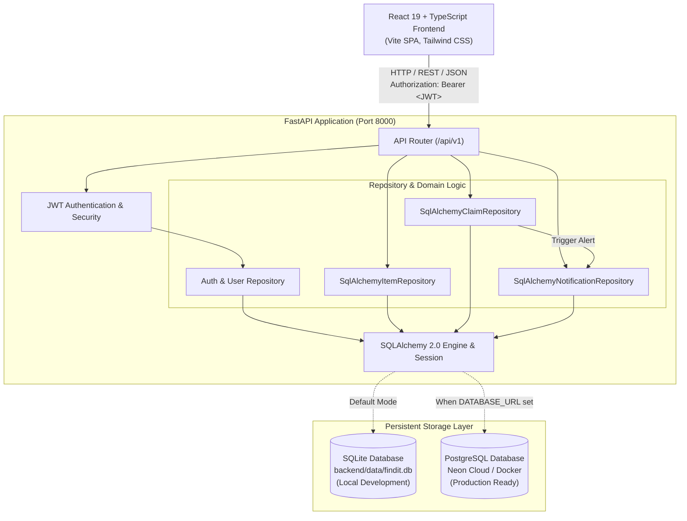
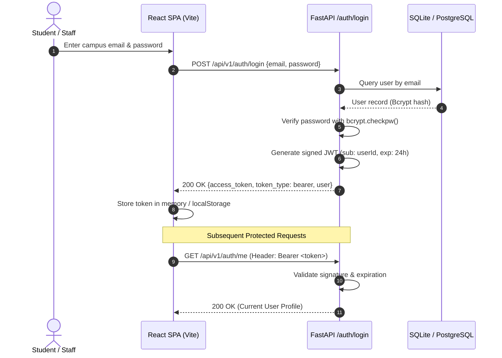
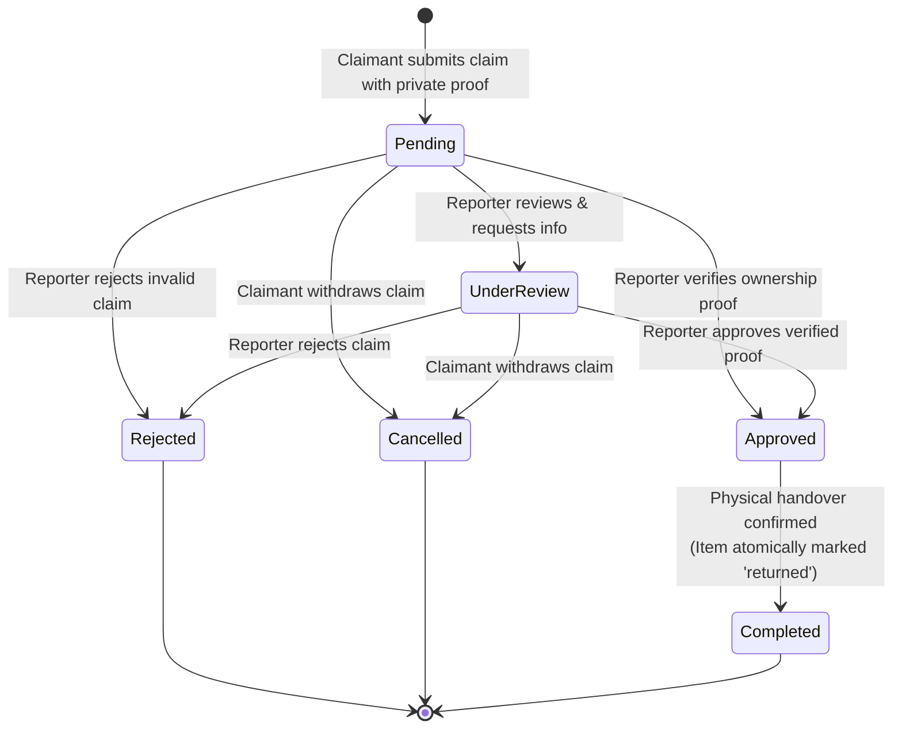
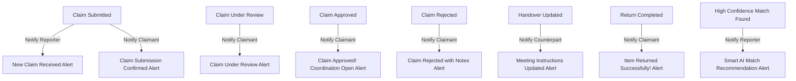
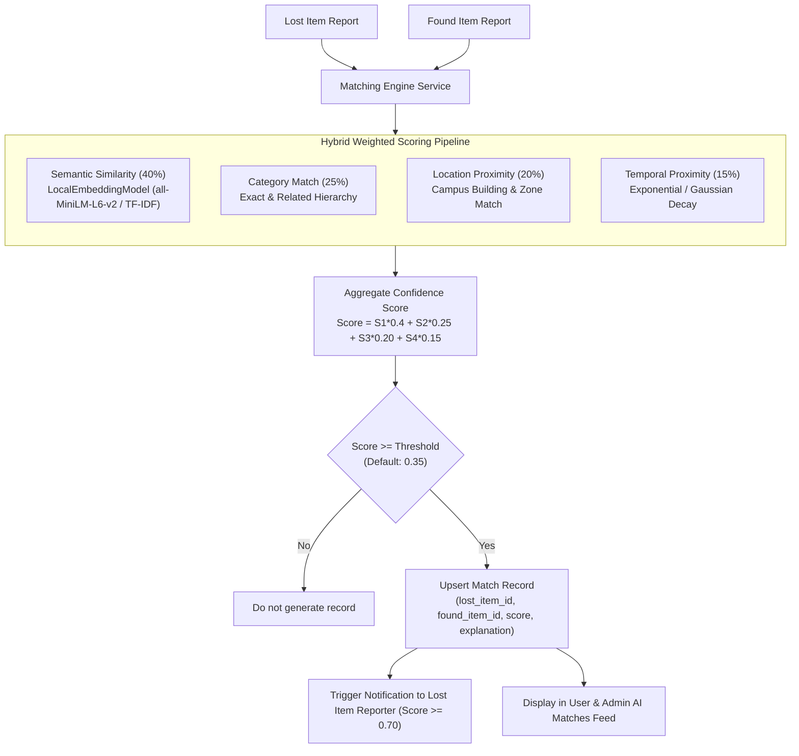

# FindIt — System Architecture & Technical Specifications

> **Architecture Style:** Decoupled Client-Server SPA Architecture  
> **Backend Framework:** FastAPI (Python 3.11+, ASGI / Uvicorn)  
> **Frontend Framework:** React 19 + TypeScript + Vite  
> **ORM & Database:** SQLAlchemy 2.0 with Alembic Migrations  
> **Storage Support:** SQLite (Local Development) & PostgreSQL (Production / Cloud)

---

## 1. High-Level System Architecture

The following diagram illustrates the complete end-to-end data flow between the React SPA client, FastAPI API gateway, domain repositories, security services, and persistent databases.

---

## 2. Authentication & Authorization Architecture

Authentication is stateless and uses standard JSON Web Tokens (JWT) signed with HMAC-SHA256.

---

## 3. Claim Lifecycle & Item Return State Machine

Ownership verification is protected by a strict finite state machine on the backend that prevents invalid transitions, duplicate claims, and claimant self-approvals.

### Transition Authorization Matrix

| Action | Source Status | Target Status | Authorized Roles | Side Effects |
|---|---|---|---|---|
| **Submit Claim** | — | `pending` | Authenticated Non-Owner | Notifies Reporter and Claimant |
| **Review Claim** | `pending` | `under_review` | Item Reporter, Admin | Notifies Claimant with review notes |
| **Approve Claim**| `pending`, `under_review` | `approved` | Item Reporter, Admin | Sets `handover_status = awaiting_handover`; notifies Claimant |
| **Reject Claim** | `pending`, `under_review` | `rejected` | Item Reporter, Admin | Notifies Claimant with rejection reason; Item remains available |
| **Cancel Claim** | `pending`, `under_review` | `cancelled` | Claimant, Admin | Notifies Reporter; Item remains available |
| **Update Handover**| `approved` | `approved` | Reporter, Claimant, Admin | Updates handover details & meeting instructions; alerts counterpart |
| **Complete Return**| `approved` | `completed` | Item Reporter, Admin | Sets `handover_status = returned_successfully`; atomically sets `item.status = returned` |

---

## 4. In-App Notification Dispatch System

Every event in the claim and return lifecycle automatically persists an isolated notification for the relevant party:

---

## 5. AI-Powered Smart Matching Engine Architecture

The FindIt matching engine pairs newly submitted and existing lost and found reports using a multi-attribute hybrid scoring model.

### Hybrid Scoring Formulation
The overall match confidence $C \in [0.0, 1.0]$ is computed as:
$$C = 0.40 \times S_{\text{semantic}} + 0.25 \times S_{\text{category}} + 0.20 \times S_{\text{location}} + 0.15 \times S_{\text{temporal}}$$

- **Semantic Text Similarity ($S_{\text{semantic}}$):** Concatenates title and description, runs embeddings through `LocalEmbeddingModel` with cosine similarity, or falls back to pure-Python TF-IDF with synonym clustering.
- **Category Match ($S_{\text{category}}$):** Yields $1.0$ for exact string match; $0.5$ for compatible super-categories (e.g., electronics vs accessories).
- **Location Proximity ($S_{\text{location}}$):** Yields $1.0$ for exact building matches; partial credit for campus zone overlap.
- **Temporal Proximity ($S_{\text{temporal}}$):** Evaluates $|date_{lost} - date_{found}|$. A 0-day difference yields $1.0$, decaying smoothly over days.

